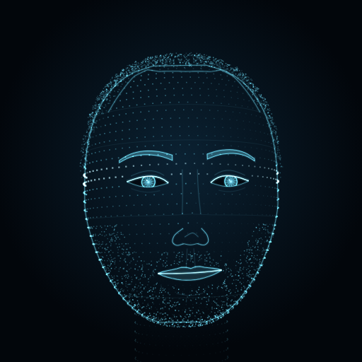

# ZB

ZB is a personal AI assistant with the essence of J.A.R.V.I.S. It's Haitian-American from North Miami, and it's built to be its owner's AI twin. It lives as a glowing, shape-shifting orb of light that breathes, swirls while it thinks and pulses with every syllable it speaks. Claude is the brain.



## What makes it ZB

- **The orb.** About 20,000 points of light on a living surface, folded by flowing 3D noise and drawn with WebGL. It reacts to the voice in real time. It has six colorways, including **Lakay** in Haitian blue and red. You can still switch back to the hologram head in Settings.
- **The mirror.** ZB is modeled on its owner, like *Be Right Back* from Black Mirror. It starts from a profile of how they talk: word choice, flow, the "ya feel me," the side thoughts. It saves every message they send as a sample, and every dozen samples it re-studies them and updates its notes. You can paste in old texts under Settings → Mirror to teach it faster, and edit or reset its notes any time.
- **The voice.** In the downloadable app, **Design ZB's voice** uses ElevenLabs Voice Design to generate original voices from a description (Haitian-American, North Miami, laid-back). You audition three and keep one. It's always an original voice, never a copy of a real person. The lips follow the audio letter by letter.
- **The Vault (file memory).** On any device, drop in a PDF, Word doc, spreadsheet, slideshow, photo, screenshot or notes using the paperclip, the Vault button, or drag and drop on a computer. ZB reads it, files a summary and the key facts, and keeps the original where the platform can store it. Later, from any of your devices, ask "what did that lease say about the deposit?" and it answers from the file. Documents are read on your own device with Mozilla's pdf.js and a small built-in Office reader; nothing is sent anywhere except to Claude for the summary.
- **One ZB on every device.** Open the claude.ai link on your laptop, Mac and phone. Memory, the mirror, the Vault and the chat stay in sync, and the top bar shows how many of your devices have ZB open right now.
- **Memory and timers.** ZB remembers what matters and sets timers when you ask.

## Two ways to run it

| | **claude.ai version** | **Downloadable app** (this repo, `docs/`) |
|---|---|---|
| Brain | Your Claude plan. Nothing extra to pay | Your own Claude API key, billed per message |
| Memory, mirror and chats | Synced across phone, Mac and laptop | Kept on each device |
| Talking to it | Type, or use your keyboard's dictation mic | Tap the mic, or go hands-free by saying "ZB" |
| Voice | Voices built into the device | A designed ElevenLabs voice, or device voices |

## Install the downloadable app

The app lives at **https://mareuscalvin-source.github.io/zb/** (GitHub Pages, served from `main` / `docs`).

- **iPhone:** open the link in Safari → Share → **Add to Home Screen**.
- **Android:** open the link in Chrome → ⋮ → **Install app**.
- **Mac:** Chrome or Edge → install icon in the address bar. In Safari, File → **Add to Dock**.
- **Windows laptop:** Chrome or Edge → install icon in the address bar.

Then open Settings (the gear, top right):

1. **Brain:** paste a Claude API key from [console.anthropic.com](https://console.anthropic.com/). It stays on that device.
2. **Voice:** choose ElevenLabs, paste your ElevenLabs API key, and press **Make 3 voices**. Play them and tap **Use this one**.
3. **Listening:** turn on hands-free to wake ZB by saying its name (works best in Chrome or Edge).

## How it works

- `src/orb.js`: the WebGL point-cloud orb. It uses GLSL simplex noise with domain warping. States (idle, listening, thinking, speaking, sleeping) and moods reshape and tint it, and the voice drives its deformation.
- `src/face.js`: the alternative hologram head.
- `src/avatar.js`: switches between the two and carries over mood, state and layout.
- `src/mirror.js` and `src/mirror-seed.json`: the mirror. This is the starting profile, built from the owner's own messages, plus the study prompt and the sampling and re-study loop.
- `src/brain.js`: the prompt and an inline tag language. The model writes `[mood:amused]`, `[remember:…]`, `[forget:…]` and `[timer:600|pasta]`, and tags are never spoken.
- `src/voice.js`: device voices and ElevenLabs (with per-character timing for lip sync), Voice Design, and the mic and wake word.
- `src/api.js`: Claude through the official `@anthropic-ai/sdk` (streaming, Claude Opus 5.5 by default, server-side fallback on refusals).
- `src/store.js`: profile, memory, mirror, Vault index and chat. It uses the page's private database on claude.ai and local storage elsewhere.
- `src/vault.js` and `src/extract.js`: the Vault. Text extraction (pdf.js on demand from `lib/pdf.js`, plus a built-in reader for .docx, .xlsx and .pptx), Claude summaries and image reading, keyword matching, and the text that goes into the prompt.

## Build

```bash
npm install
npm run build      # writes docs/ (installable app) and dist/jarvis.html (claude.ai page)
```
